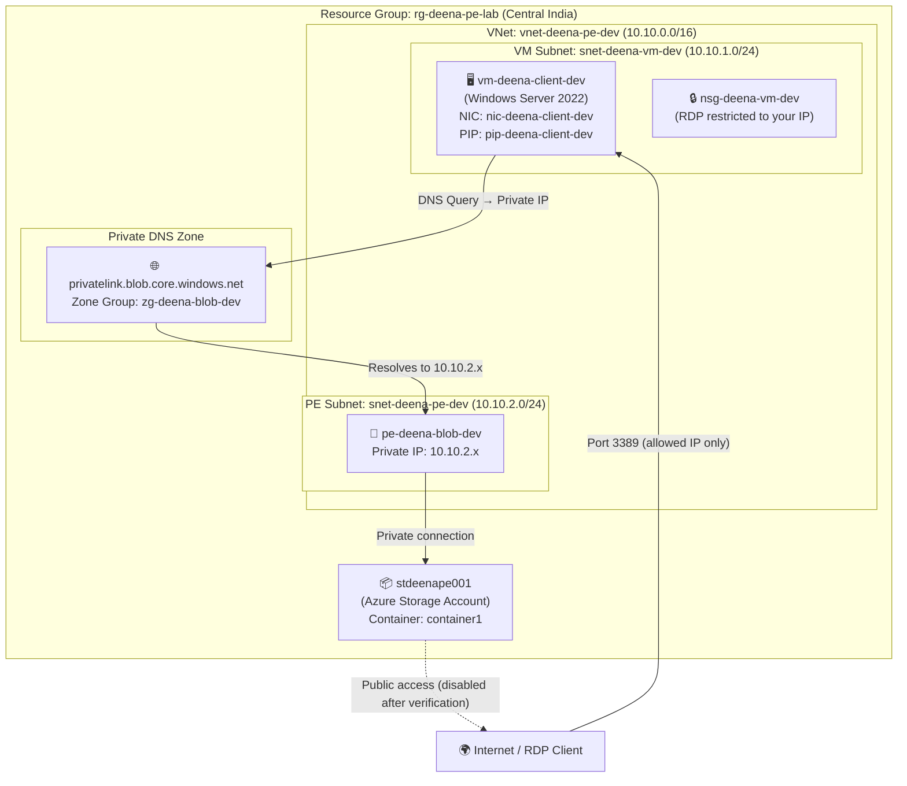

# Azure Private Endpoint Lab — Terraform

A production-style hands-on lab that deploys an **Azure Storage Account with Blob Private Endpoint** so that a Windows VM inside an Azure Virtual Network accesses Blob Storage through a **private IP address** — never over the public internet.

Built with Terraform following the **Microsoft Cloud Adoption Framework (CAF)** naming convention and Terraform module best practices. Suitable for a real-world DevOps portfolio and GitHub publication.

---

## Architecture Diagram



---

## Resource Naming Convention (CAF)

| Resource | Name |
|---|---|
| Resource Group | `rg-deena-pe-lab` |
| Virtual Network | `vnet-deena-pe-dev` |
| VM Subnet | `snet-deena-vm-dev` |
| PE Subnet | `snet-deena-pe-dev` |
| NSG | `nsg-deena-vm-dev` |
| Windows VM | `vm-deena-client-dev` |
| NIC | `nic-deena-client-dev` |
| Public IP | `pip-deena-client-dev` |
| Storage Account | `stdeenape001` *(configurable)* |
| Blob Container | `container1` |
| Private Endpoint | `pe-deena-blob-dev` |
| Private DNS Zone | `privatelink.blob.core.windows.net` |
| DNS Zone Group | `zg-deena-blob-dev` |

---

## Project Structure

```
Azure-Private-Endpoint-Lab/
│
├── environments/
│   └── dev/
│       ├── main.tf          # Root module — wires all child modules
│       ├── variables.tf     # Input variable declarations
│       ├── terraform.tfvars # Variable values (non-secret)
│       ├── outputs.tf       # Useful outputs
│       └── providers.tf     # AzureRM provider + backend config
│
├── modules/
│   ├── resource-group/      # Resource Group
│   ├── networking/          # VNet + subnets
│   ├── nsg/                 # NSG + rules
│   ├── virtual-machine/     # Windows VM + NIC + Public IP
│   ├── storage-account/     # Storage Account + container
│   ├── private-endpoint/    # Private Endpoint
│   └── private-dns/         # Private DNS Zone + VNet link + zone group
│
├── scripts/
│   ├── connectivity-test.ps1
│   └── dns-test.ps1
│
├── .gitignore
└── README.md
```

---

## Prerequisites

| Tool | Version | Notes |
|---|---|---|
| [Terraform](https://developer.hashicorp.com/terraform/downloads) | >= 1.5.0 | `terraform -version` |
| [Azure CLI](https://learn.microsoft.com/en-us/cli/azure/install-azure-cli) | Latest | `az --version` |
| Azure Subscription | Active | Contributor or Owner role |
| PowerShell | 5.1 / 7+ | For testing scripts |

---

## Azure Authentication

### Option A — Azure CLI (recommended for local dev)

```powershell
az login
az account set --subscription "<your-subscription-id>"
az account show   # confirm correct subscription
```

### Option B — Service Principal (CI/CD pipelines)

```powershell
$env:ARM_CLIENT_ID       = "<appId>"
$env:ARM_CLIENT_SECRET   = "<password>"
$env:ARM_TENANT_ID       = "<tenantId>"
$env:ARM_SUBSCRIPTION_ID = "<subscriptionId>"
```

---

## Deployment Steps

### 1. Clone the repository

```powershell
git clone https://github.com/<your-username>/Azure-Private-Endpoint-Lab.git
cd Azure-Private-Endpoint-Lab
```

### 2. Update `terraform.tfvars`

Open `environments/dev/terraform.tfvars` and set:

```hcl
# Required — must be globally unique (3-24 chars, lowercase, no hyphens)
storage_account_name = "stdeenape001"

# Required — restrict RDP to your public IP
admin_rdp_source_ip = "203.0.113.10/32"   # replace with your IP

# Optional overrides
location = "centralindia"
```

> **Never** commit VM credentials to `terraform.tfvars`. Pass them as environment variables or use `-var` flags.

### 3. Set sensitive variables

```powershell
# PowerShell
$env:TF_VAR_vm_admin_username = "azureadmin"
$env:TF_VAR_vm_admin_password = "YourStr0ng!Pass"
```

### 4. Navigate to the dev environment

```powershell
cd environments/dev
```

### 5. Initialise Terraform

```powershell
terraform init
```

### 6. Format and validate

```powershell
terraform fmt -recursive
terraform validate
```

### 7. Plan

```powershell
terraform plan -out=tfplan
```

Review the plan carefully. Expected resource count: ~15.

### 8. Apply

```powershell
terraform apply tfplan
```

Type `yes` when prompted (or use `-auto-approve` for pipelines).

### 9. Note the outputs

```powershell
terraform output
```

Key outputs:
- `vm_public_ip` — RDP connection address
- `storage_account_name` — Storage Account name
- `private_endpoint_ip` — Private IP assigned to the PE

---

## Testing the Private Endpoint

### Connect to the VM

```powershell
# Get the public IP
terraform output vm_public_ip

# RDP from your machine
mstsc /v:<vm_public_ip>
```

Log in with the credentials you set in `TF_VAR_vm_admin_username` / `TF_VAR_vm_admin_password`.

### Copy testing scripts to the VM

Copy `scripts/dns-test.ps1` and `scripts/connectivity-test.ps1` to the VM via RDP drag-and-drop or:

```powershell
# From your local machine (requires WinRM or PSRemoting)
Copy-Item -Path "..\..\scripts\*.ps1" -Destination "C:\scripts\" -ToSession $session
```

### Run DNS test

```powershell
# On the VM — PowerShell as Administrator
Set-ExecutionPolicy Bypass -Scope Process -Force
.\dns-test.ps1 -StorageAccountName "stdeenape001"
```

Expected output:
```
[PASS] DNS resolves to PRIVATE IP: 10.10.2.x
[PASS] IP is within PE subnet range 10.10.2.0/24
[PASS] No public IP returned
```

### Run connectivity test

```powershell
.\connectivity-test.ps1 -StorageAccountName "stdeenape001" -ContainerName "container1"
```

Expected output:
```
[PASS] TCP port 443 reachable via private endpoint
[PASS] HTTPS connectivity to Blob storage endpoint successful
[PASS] Blob container accessible over private network
```

---

## How Private DNS Works

When you create a Private Endpoint, Azure assigns a **private IP** (e.g., `10.10.2.4`) to the NIC inside your VNet.

Without Private DNS, `nslookup stdeenape001.blob.core.windows.net` from inside the VM would return the **public IP** — traffic would still leave the VNet.

The Private DNS Zone `privatelink.blob.core.windows.net` overrides this by adding an **A record**:

```
stdeenape001.privatelink.blob.core.windows.net  →  10.10.2.4
```

Azure's internal DNS auto-resolves `stdeenape001.blob.core.windows.net` → `stdeenape001.privatelink.blob.core.windows.net` → `10.10.2.4`.

The **VNet Link** connects the DNS Zone to `vnet-deena-pe-dev` so VMs in that VNet use this override automatically.

---

## Private Endpoint vs Service Endpoint

| Feature | Private Endpoint | Service Endpoint |
|---|---|---|
| Network path | Fully private (RFC 1918 IP) | Public IP, optimised route |
| DNS override | Yes — private IP returned | No — public IP |
| Resource access | Single resource instance | All resources of that type |
| Cross-region | Yes | No |
| Exfiltration protection | Strong | Weaker |
| Cost | NIC + zone + DNS queries | Free |
| Use case | Production security | Dev / cost-sensitive |

---

## Troubleshooting

### DNS resolves to public IP from VM

- Verify the VNet Link is `Registered` (not just created).
- Check the DNS Zone Group is attached to the correct PE.
- Flush DNS on the VM: `ipconfig /flushdns`.

### RDP connection refused

- Confirm your public IP matches `admin_rdp_source_ip` in NSG.
- Check the VM is in `Running` state: `az vm show -g rg-deena-pe-lab -n vm-deena-client-dev --query powerState`.

### Storage Account 403 / AuthorizationFailure

- Ensure the Storage Account firewall allows your VM's subnet or that public access is still enabled.
- Check that the Private Endpoint provisioning state is `Succeeded`.

### Private Endpoint IP not in PE subnet

- Verify `enforce_private_link_endpoint_network_policies` is set correctly for the PE subnet.

### Terraform plan shows no changes but PE not working

Run:
```powershell
az network private-endpoint show \
  --resource-group rg-deena-pe-lab \
  --name pe-deena-blob-dev \
  --query "privateLinkServiceConnections[0].privateLinkServiceConnectionState"
```
Status should be `Approved`.

---

## Disable Public Access (after verification)

Once Private Endpoint connectivity is confirmed, restrict the Storage Account:

```hcl
# In environments/dev/terraform.tfvars
storage_public_network_access_enabled = false
```

```powershell
terraform apply -var="storage_public_network_access_enabled=false"
```

---

## Cleanup

Destroy all resources to avoid charges:

```powershell
cd environments/dev
terraform destroy
```

Type `yes` when prompted. This removes **all** resources created by this lab.

Verify deletion:
```powershell
az group show --name rg-deena-pe-lab
# Expected: ResourceNotFound
```

---

## Tags Applied to All Resources

```hcl
Environment = "Development"
Project     = "Azure-Private-Endpoint-Lab"
ManagedBy   = "Terraform"
Owner       = "Deenanath"
```

---

## License

MIT — free to use, fork, and adapt for your own portfolio or learning.
